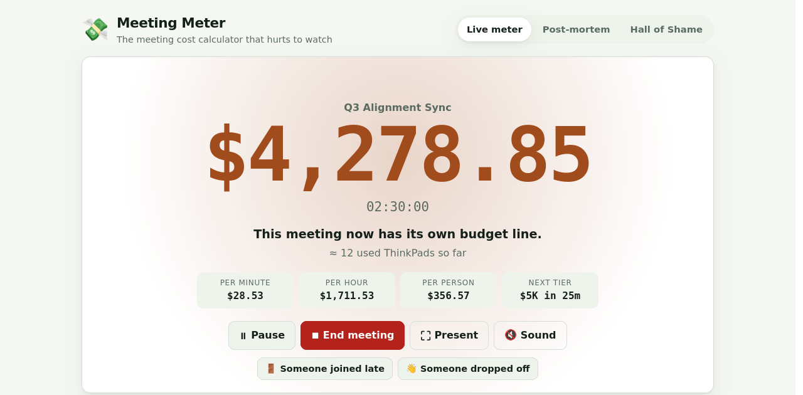

# 💸 Meeting Meter: The Meeting Cost Calculator That Hurts to Watch

**Every meeting has a price tag. Now you can watch it climb, one cent at a time.**

Meeting Meter is a free, **real-time meeting cost calculator**. Tap start, and a giant ticker shows exactly **how much this meeting costs** as it happens, based on real U.S. salary data for the people in the room. No sign-up, no spreadsheets, no data entry. It just counts dollars in front of everyone until somebody says "let's take this offline."

[](https://buymeacoffee.com/strifer.btw)

### [▶ Try it live, free](https://freereins.github.io/meeting-cost-calculator/)

[](https://freereins.github.io/meeting-cost-calculator/)

---

## Why you'll love it

- ⚡ **One tap to start.** No setup required. It assumes five average people until you tell it otherwise.
- 🧑‍💼 **Zero data entry.** Pick from 130+ real roles across 21 industries, from Software Engineers and Nurses to Line Cooks, Actuaries and The CEO. Salaries are already loaded.
- 🚪 **Change the room mid-meeting.** Someone joined late? Tap once. The cost from that moment on updates, and what you've already burned stays burned.
- 🔥 **It gets funnier the worse it gets.** The ticker shifts from green to red, money rains down, the screen shakes at $1,000, and the commentary escalates from *"This could have been an email"* to *"Welcome to the 50K Club."*
- 🧾 **A receipt for every meeting.** Line items per role, "Decisions made: 0", "Tip: 0%". Copy it, share it, or save it as an image.
- 🏆 **Hall of Shame.** Your most expensive meetings, ranked, with lifetime totals and badges like *Marathon* and *Used Car Lot*.
- 📆 **Recurring meeting cost.** See what your weekly standup really costs per year. (Sit down first.)
- 🔗 **Invite links.** Pre-fill the room and drop the link in a calendar invite, so the meter is ready when the meeting starts.
- 🖥️ **Presentation mode.** Full-screen ticker for the shared screen. Maximum accountability.
- 🔒 **100% private.** Everything runs in your browser. No accounts, no tracking, no server. Your shame stays local.

## How it works

1. **Start.** Hit the big button when the meeting begins. Forgot? Tell it you started 10 minutes ago.
2. **Watch.** The meter adds up each attendee's hourly cost in real time and narrates your descent.
3. **Regret.** End the meeting, collect your receipt, and add it to the Hall of Shame.

**The math:** each attendee's average annual salary ÷ 2,080 working hours = cost per hour, summed across the room and counted by the millisecond. Flip on **fully loaded cost** to add ~40% for benefits, payroll taxes and overhead (and yes, the office snacks).

## Perfect for

- Daily standups that are no longer standing or daily-length
- All-hands meetings with 200 people and 2 speakers
- "Quick syncs" that are neither
- Sprint planning, retros, and the retro about the retro
- Quietly making a point to your manager. Or loudly, with Presentation mode.

## FAQ

### How is the cost of a meeting calculated?
For each person, Meeting Meter takes the average annual wage for their role and industry, divides it by 2,080 hours (40 hours × 52 weeks), and adds everyone up. The total accrues every millisecond while the meeting runs. Pauses are free, and people who join or leave only count while they're in the room.

### Where does the salary data come from?
The [U.S. Bureau of Labor Statistics Occupational Employment and Wage Statistics (OEWS)](https://www.bls.gov/oes/) program, May 2025 national estimates by industry. The data is public domain. A few roles BLS doesn't publish are marked "≈" and use a conservative low-end estimate. The "Special Guests" (like the $400/hr Outside Consultant or Someone's Dog on Camera) are jokes, not data.

### Is my meeting data stored anywhere?
Only in your own browser's local storage. Nothing is ever sent to a server. There's no server to send it to. You can export your Hall of Shame as a file to move it between browsers.

### Can I calculate the cost of a recurring meeting?
Yes. Open **Post-mortem**, pick who attends, enter how long it runs, and choose daily, weekly, every two weeks, or monthly. You'll get the cost per meeting and per year.

### Does it work on my phone?
Yes. It's a plain web page that works in any modern browser, on any device.

### Is it accurate?
It's a good-faith estimate built on real averages, so it's accurate enough to be uncomfortable. Real salaries vary by company, location, and seniority, and real meetings vary by how many people are secretly answering email.

---

## For developers

Meeting Meter is **one self-contained HTML file**: all the CSS, JavaScript and salary data live inside [`index.html`](index.html). No build step, no server, no framework, no `npm install`. **Just open `index.html` in your browser** and it works, even if it's the only file you downloaded, it arrived as an email attachment, or your browser is sandboxed (e.g. a Flatpak).

```sh
git clone https://github.com/freereins/meeting-cost-calculator.git
# then double-click meeting-cost-calculator/index.html. That's it.
```

Inside `index.html`, the code is split into labeled `<script data-src="js/…">` blocks (cost math, session, storage, humor, UI, …). Each block registers itself on a global `MM` namespace, and they run in order, with `js/main.js` last. Edit the file directly. There's nothing to compile.

Handy URL parameters while developing:

| Parameter | What it does |
| --- | --- |
| `?speed=100` | Time runs 100× faster, so you can watch every tier fire in a minute |
| `?demo=45` | Auto-starts a meeting that "began" 45 minutes ago |

### Tests

The cost math, session state machine, share links, and storage are tested with Node's built-in test runner, reading the code straight out of `index.html`. No dependencies are needed:

```sh
node --test 'tests/*.test.js'     # or: npm test
```

Because the tests read the code out of `index.html` itself, they always test exactly what the browser runs.

### Refreshing the salary data

Salaries live in the `<script data-src="js/data/salaries.js">` block of `index.html`, which is generated from the BLS public API by an optional, dependency-free Python script. You never need to run it to use the site; it's only for refreshing the numbers. The roles and industries it pulls are listed in [`scripts/roles.config.json`](scripts/roles.config.json). Edit that file to add or relabel roles, then run:

```sh
python3 scripts/build_salaries.py
```

Without an API key, BLS allows roughly 25 requests per day, and a full refresh takes about 19. Responses are cached in `scripts/.cache/`, so if you hit the limit, run it again tomorrow and it picks up where it left off. A free [BLS API key](https://data.bls.gov/registrationEngine/) raises the limits: `BLS_API_KEY=... python3 scripts/build_salaries.py`. Use `--offline` to rebuild from the cache alone.

### Project layout

```
index.html            the whole app: markup, SEO metadata, styles, and these script blocks:
  js/data/salaries.js     generated BLS salaries (rewritten by scripts/build_salaries.py)
  js/data/jokeRoles.js    hand-written "Special Guests"
  js/cost.js, session.js  pure cost math + meeting state machine (segments, pauses, late starts)
  js/storage.js           versioned localStorage wrapper
  js/share.js             invite-link encoding
  js/humor/*              tiers, quips, equivalents, badges, meeting names
  js/ui/*                 role picker, money rain, receipt, Hall of Shame, sound
  js/main.js              wires the UI together (runs last)
scripts/              salary data refresh
tests/                node --test suites
```

### Deploy your own copy

Fork the repo, then go to **Settings → Pages → Build and deployment**, choose **Deploy from a branch**, and select `main` / `/ (root)`. That's the whole deployment. If your URL differs, update the canonical/Open Graph URLs in `index.html`, `robots.txt`, and `sitemap.xml`.

## Support

Enjoying Meeting Meter? Star the repository, share it with someone stuck in too many meetings, or [buy me a coffee](https://buymeacoffee.com/strifer.btw).

## Credits & license

Salary data: U.S. Bureau of Labor Statistics, Occupational Employment and Wage Statistics (public domain). Meeting Meter is not affiliated with or endorsed by BLS.

Code released under the [MIT License](LICENSE). Go forth and make meetings shorter.
